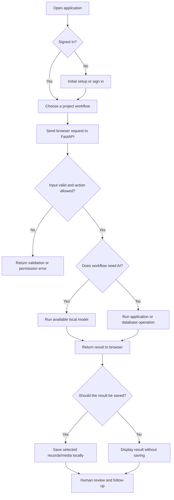
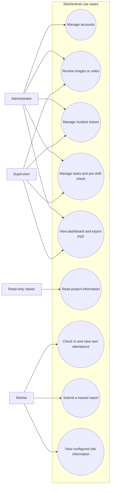
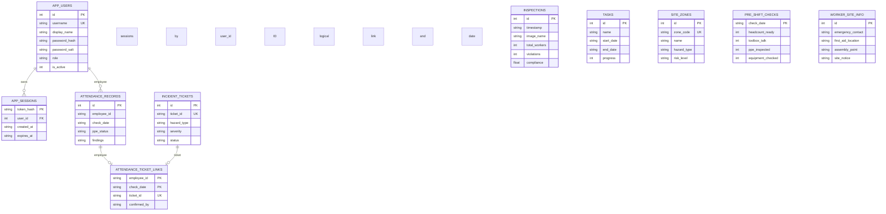

<div align="center">

# SiteSentinel

### Local construction project and safety review application

**Review possible hazards · Follow up on incidents · Check in workers · Track project readiness**

Python · FastAPI · SQLite · HTML/CSS/JavaScript · Computer vision

</div>

> **Project boundary:** SiteSentinel is a student project for trusted local demonstration. It is not certified safety software, a substitute for professional judgment, or ready for public deployment. AI output can be incorrect and must be reviewed by a person.

## Project information

| Item | Details |
|---|---|
| Project name | SiteSentinel |
| Domain | Construction project and safety review |
| Application type | Browser interface with a local Python web server |
| Primary users | Administrators, supervisors, read-only viewers, and workers |
| Backend | Python, FastAPI, Uvicorn |
| Frontend | HTML, CSS, JavaScript |
| Database | Local SQLite |
| Main use | Demonstrate a collection of construction-site review and project workflows in one local application |
| Team number | **Add the verified team number; it is not recorded in this repository.** |
| Team members / roll numbers | **Add each member's name and roll number from your team records.** |
| Institution / course / project guide | **Add verified academic details if required.** |

Use the sections below as source material for a project presentation or report. The repository does not establish team details, institutional information, or the exact history of AI coding-tool use; fill those from your team's records rather than guessing.

## Contents

1. [Abstract](#1-abstract)
2. [Introduction and motivation](#2-introduction-and-motivation)
3. [Problem statement](#3-problem-statement)
4. [Objectives](#4-objectives)
5. [Existing system and proposed solution](#5-existing-system-and-proposed-solution)
6. [System design and architecture](#6-system-design-and-architecture)
7. [Tools and technologies used](#7-tools-and-technologies-used)
8. [AI-assisted coding approach](#8-ai-assisted-coding-approach)
9. [Implementation](#9-implementation)
10. [Results and screenshots](#10-results-and-screenshots)
11. [Testing and validation](#11-testing-and-validation)
12. [Conclusion](#12-conclusion)
13. [Future enhancements](#13-future-enhancements)
14. [References](#14-references)
15. [Appendix A: Run and develop the project](#appendix-a-run-and-develop-the-project)
16. [PPT slide sequence](#ppt-slide-sequence)

---

## 1. Abstract

SiteSentinel is a local, browser-based construction project and safety review application. It brings together photo and sampled-video review for possible hazards, restricted-zone checks, incident tickets, worker PPE check-in, attendance, task tracking, a daily pre-shift checklist, regional air-quality and weather information, role-based accounts, and PDF project summaries. A FastAPI server connects the browser interface to Python application modules, locally supplied computer-vision models, and a SQLite database. Worker access is separated from supervisor and administrator workflows. The application is intended for demonstration and human-reviewed assistance; it does not certify safety, verify worker identity, or provide continuous site monitoring. The repository does not preserve the original AI coding-tool history, so a specific tool or AI-generated contribution cannot be verified from these files.

## 2. Introduction and motivation

Construction sites involve changing work areas, protective-equipment requirements, equipment movement, and day-to-day readiness checks. Project information may be handled in separate forms and records, while visual checks and follow-up still depend on people reviewing evidence.

SiteSentinel explores how a single local application can support several related tasks:

- Review an image or sampled video for possible PPE or other hazards.
- Record a concern and let a supervisor follow its status.
- Record a worker's check-in without retaining the check-in photograph.
- Keep task, attendance, pre-shift, site-information, and ticket records in one local database.
- Give workers a limited dashboard and a way to send a concern to the supervisor workflow.
- Present regional environmental information with clear disclosure that it is not an onsite measurement.

The project is in the construction safety and project-management domain. Its purpose is to demonstrate software workflows, not to replace qualified site staff, safety procedures, or physical inspections.

## 3. Problem statement

The project addresses a workflow and information-management problem: a small project may use separate tools or manual records for visual reviews, attendance, readiness checks, tasks, incidents, and project summaries. This can make it harder to find related information or follow an issue through to resolution.

The application investigates whether these activities can be presented through one local interface. The computer-vision portion may help flag items for human review, but it does not solve the broader problem of confirming real-world safety. Detection can be missed or incorrect, model accuracy has not been independently measured, and site conditions still require qualified human assessment.

## 4. Objectives

1. Provide a browser interface for common construction project and safety-review workflows.
2. Accept image and video review requests and return visual annotations and structured detection summaries when the required models are available.
3. Support manual incident creation, evidence, notes, status updates, and supervisor follow-up.
4. Provide worker check-in and personal attendance views while avoiding storage of check-in photos.
5. Separate administrator, supervisor, viewer, and worker permissions.
6. Support task tracking, a pre-shift checklist, configured site information, and an illustrative site map.
7. Display regional air-quality and weather information, keeping modeled values distinct from onsite measurements.
8. Store project records locally in SQLite and export a PDF summary.
9. Validate core behavior with automated tests and document known limitations.

## 5. Existing system and proposed solution

### General workflow comparison

| Common/manual workflow | SiteSentinel's proposed support |
|---|---|
| Visual checks and incident follow-up may be tracked separately. | Image/video review and incident tickets are available in the same application. |
| Attendance or daily readiness may use separate records. | Worker check-in, attendance history, tasks, and pre-shift checks use the project interface and local records. |
| Project information may be difficult to summarize quickly. | A dashboard and downloadable PDF summarize selected local project records. |
| Every user may not need the same data or actions. | Role-based access distinguishes administrator, supervisor, viewer, and worker operations. |

This is a comparison with a general manual workflow, not a measured comparison against a named commercial product.

### Proposed solution and project contribution

The proposed solution is a local web application with a browser frontend, FastAPI endpoints, Python modules for business and AI workflows, SQLite persistence, and optional local model files. Its project-level contribution is the integration of several demonstration workflows with role restrictions and explicit human-review limitations. This is an application integration contribution, not a claim of a novel AI model or a validated safety method.

## 6. System design and architecture

### High-level architecture

```text
┌─────────────────────────────────────────────┐
│ Browser                                    │
│ HTML · CSS · JavaScript · Chart.js · Lucide│
└──────────────────────┬──────────────────────┘
                       │ HTTP / JSON / file uploads
                       ▼
┌─────────────────────────────────────────────┐
│ FastAPI application (web/api.py)            │
│ Routes · validation · authentication · roles│
└────────────┬────────────────┬───────────────┘
             │                │
             ▼                ▼
┌──────────────────────┐  ┌────────────────────────┐
│ Python app modules   │  │ External data provider │
│ Detection · tickets  │  │ Open-Meteo lookups and │
│ Attendance · reports │  │ regional weather data │
└──────────┬───────────┘  └────────────────────────┘
           │
           ├─────────────► Local YOLO model files (optional)
           │
           └─────────────► SQLite database and local media
                            data/records.db · data/
```

### Request and review workflow

1. A user opens the application and signs in or completes the initial administrator setup.
2. The browser sends an API request to the FastAPI application.
3. The server checks authentication, role permissions, input format, and applicable file constraints.
4. Python modules perform the requested workflow. A visual-review endpoint invokes a local model when its required weights are present.
5. The server returns a structured response and, where applicable, an annotated image/video.
6. Selected operational data is stored in SQLite or local media folders.
7. A person reviews AI results and decides whether to take action. AI detections do not automatically create incident tickets.

### Workflow flowchart



### Use-case view



The diagram summarizes the intended role workflows; individual endpoint permissions are enforced in the application and covered by tests.

### Main API groups

The FastAPI application defines endpoint groups for account setup and login, health and dashboard statistics, attendance and worker site information, environmental lookups, pre-shift checks, inspections, image/video/restricted-zone detection, tasks, PDF reports, frame processing, evidence, incident tickets, risk summaries, and site zones. The routes are implemented in [`web/api.py`](web/api.py).

### Data design

The database is a local SQLite file at `data/records.db`. The schema is initialized by `app/database.py` and includes these main tables:

| Table | Purpose |
|---|---|
| `app_users` | Usernames, display names, password hashes, roles, and active state. |
| `app_sessions` | Hashed session tokens, user association, creation time, and expiry. |
| `inspections` | Saved photo-inspection summary values and optional annotated-image path. |
| `incident_tickets` | Incident type, severity, description, evidence name, status, worker link, and supervisor notes. |
| `site_zones` | Configured zone names, hazard types, risk levels, and active state. |
| `attendance_records` | Worker/date check-in result and text findings; check-in photos are not stored. |
| `attendance_ticket_links` | Link between a worker's daily attendance and a confirmed ticket. |
| `tasks` | Task name, start/end dates, and progress. |
| `pre_shift_checks` | Daily readiness checklist values and update information. |
| `worker_site_info` | Administrator-configured emergency, first-aid, assembly, and site-notice values. |

Generated/review media is stored under subfolders of `data/`. The project has a database migration for existing user tables when enabling the worker role. This README summarizes the schema; it is not a formal ER diagram.

### Conceptual entity relationship diagram



Only the user-to-session link is declared as a database foreign key in this diagram. Other links shown are application-level associations; the schema does not enforce them as foreign keys.

## 7. Tools and technologies used

### Application stack

| Layer | Technology | Role in this project |
|---|---|---|
| Programming language | Python 3.11 (used by the CI workflow) | Backend, database access, computer-vision integration, report generation, and tests. |
| Web framework | FastAPI | HTTP API, request handling, and application routes. |
| ASGI server | Uvicorn | Runs the local FastAPI application. |
| Database | SQLite via Python's `sqlite3` module | Stores accounts, sessions, inspections, tickets, attendance, tasks, zones, and site information locally. |
| Frontend | HTML, CSS, JavaScript | Browser layout, interactions, and API calls. |
| CSS tooling | Tailwind CSS CLI | Builds the checked-in generated stylesheet. |
| Charts | Chart.js | Renders dashboard charts. |
| Icons | Lucide | Supplies interface icons. |
| Computer vision | Ultralytics YOLO, PyTorch, TorchVision | Loads local detection weights and performs model inference. |
| Image/video processing | OpenCV, Pillow, NumPy | Reads, samples, transforms, annotates, and validates image/video data. |
| Tabular data | Pandas | Supports inspection and summary data. |
| PDF export | fpdf2 | Generates a downloadable project summary. |
| Environmental data | Open-Meteo services | Provides location search and regional modeled weather/air-quality information; internet access is required. |
| Testing | Python `unittest` | Exercises modules, API behavior, permissions, validation, and persistence. |
| Frontend build tooling | Node.js/npm | Installs frontend development dependencies and rebuilds static assets. Node.js is not required just to serve the checked-in frontend. |
| AI coding assistance | **To be completed from team records** | Record the actual assistant/model, version, tasks, and prompts used; the repository does not retain this history. |

### Versions pinned in the repository

Python package versions are pinned in [`requirements.txt`](requirements.txt), and frontend packages are pinned in [`package.json`](package.json) and [`package-lock.json`](package-lock.json).

| Package | Pinned version |
|---|---:|
| FastAPI | 0.141.1 |
| Uvicorn | 0.52.4 |
| Ultralytics | 8.4.142 |
| PyTorch | 2.14.0 |
| TorchVision | 0.29.0 |
| OpenCV Python | 5.0.0.93 |
| Pillow | 12.3.0 |
| NumPy | 2.4.6 |
| Pandas | 3.0.5 |
| fpdf2 | 2.8.8 |
| Tailwind CSS / CLI | 4.3.3 |
| Chart.js | 4.4.3 |
| Lucide | 0.468.0 |
| Node.js in CI | 22 |

The exact SQLite library version depends on the selected Python build and is not pinned separately in this project.

## 8. AI-assisted coding approach

The repository does not contain a complete record of which AI coding tools were used for the original application, the prompts sent, prompt revisions, or which code was generated by a tool. Complete the record below from the team's own history before presenting it. Do not present the illustrative prompts as historical prompts.

| Information to report | Project team's verified record |
|---|---|
| AI coding assistant(s) and model/version | **Fill in from your usage history.** |
| Dates and development tasks where AI assistance was used | **Fill in from your notes/history.** |
| Code or documentation accepted from AI suggestions | **Identify only after reviewing the actual diffs.** |
| Human review and validation performed | **Add the actual review and test steps.** |

### Responsible workflow to describe

1. Use an AI assistant to help understand a module, draft a change, or suggest edge cases.
2. Refine a broad prompt with relevant file names, constraints, expected behavior, and test requirements.
3. Compare suggestions against the actual source, project requirements, and existing patterns.
4. Review changes manually, especially authentication, permissions, uploads, and AI-result handling.
5. Add or update focused tests and run them locally.
6. Keep human responsibility for design choices, validation, and final acceptance.

### Illustrative prompts (examples only)

- **Initial prompt:** “Add worker registration.”
- **Refined prompt:** “First inspect the existing authentication routes and tests. Propose a worker-registration change that requires the configured site invitation code, canonical unique EMP IDs, least-privilege worker access, and tests for missing/invalid codes and cross-worker data access. Do not change unrelated files.”
- **Code review prompt:** “Trace the photo-review request from the FastAPI route through the detector module. Summarize input validation, output fields, and error handling. Do not modify files.”
- **Testing prompt:** “Suggest focused tests for worker role permissions and attendance privacy. Follow existing test patterns and do not weaken authorization checks.”

These are example prompts for planning a report. They are not verified prompts used to create the existing source.

### How to explain AI-generated code and debugging

For the submitted report, identify one real, reviewed change from the team's history and record: the original task, prompt iterations, suggested code, edits made by a team member, tests run, and the final outcome. The repository alone cannot prove that any specific existing function was AI-generated. Do not label the code examples in the next section as AI-generated unless your development history confirms it.

| Development record | Fill in from a real example |
|---|---|
| Problem or bug observed | **Describe the original behavior and how it was reproduced.** |
| Prompt and refinements | **List the actual prompt versions; remove private data and credentials.** |
| AI suggestion | **Summarize the suggestion, not an unreviewed full transcript.** |
| Human changes | **Explain what the team accepted, changed, or rejected and why.** |
| Debugging and validation | **List the actual tests, commands, and observed result.** |
| Contribution | **State what AI helped with and what decisions remained with the team.** |

## 9. Implementation

### User-facing modules

| Module | What it does |
|---|---|
| Dashboard | Presents project summary information and navigation to the available workflows. |
| PPE/photo review | Runs a hardhat-oriented detector and returns detection counts, compliance summary, and an annotated image when the model is available. |
| Multi-hazard review | Supports model-assisted PPE, fall, fire/smoke, and worker/equipment-proximity checks, subject to the supplied model files and their classes. |
| Restricted-zone check | Accepts a user-drawn polygon, validates it, and checks detected person boxes against that image region. |
| Video review | Samples frames from an uploaded video, runs review logic, and produces a browser-playable annotated result when dependencies permit. The default sampling interval in the module is every five frames. |
| Incident tickets | Creates and updates tickets, supports supervisor notes and optional validated image evidence, and calculates a project-defined risk indicator. |
| Worker check-in | Processes a check-in image for PPE, stores check-in status/findings, and discards the uploaded photo. It does not verify identity. |
| Worker dashboard | Shows a worker's own attendance information, today's status, environmental information, configured site notice/emergency details, reminders, and a report form. |
| Pre-shift and task tools | Saves the daily checklist and task dates/progress. |
| Site map and zones | Presents an illustrative site layout and configured risk zones; it is not a surveyed or live map. |
| Environmental information | Provides regional location/weather information and a separate construction activity/mitigation what-if estimate. |
| PDF project summary | Exports local summary information, inspection statistics, tickets, risk indicator, and zones. It is not an official audit or certificate. |
| Account management | Supports first-admin setup, login/logout, account administration, visitor registration, and invitation-code worker registration. |

### Selected implementation examples

These short excerpts illustrate actual implementation patterns in the repository. They explain how the application works; they are not evidence that an AI tool generated the code.

**Password hashing — `app/auth.py`:**

```python
password_hash = hashlib.pbkdf2_hmac(
    "sha256", password.encode("utf-8"), salt, PASSWORD_ROUNDS
)
```

The function uses a random salt and the configured 600,000 PBKDF2 rounds; the original password is not stored.

**PPE compliance summary — `app/detector.py`:**

```python
total = helmet_ok + violations
compliance = round(helmet_ok / total * 100, 1) if total > 0 else None
```

This returns a percentage only when detections exist. It is a model result, not a measured site-wide compliance rate.

**Attendance uniqueness — `app/database.py`:**

```sql
UNIQUE(employee_id, check_date)
```

The database uses this constraint to allow at most one attendance record per employee per date.

### Feature implementation workflow

| Feature | Input | Main processing | Output / persistence |
|---|---|---|---|
| Photo review | Uploaded image and review options | Validate image, run an available detector, calculate summary | Annotated image and structured result; selected inspections may be saved |
| Restricted-zone check | Image and polygon points | Validate polygon, detect people, classify boxes against zone | Annotated image and zone classification |
| Video review | Uploaded video | Validate media, sample frames, run review logic | Browser-playable annotated video when codec support is available |
| Worker check-in | Employee ID and image | Validate request and run PPE review | Text attendance status/findings; uploaded photo is discarded |
| Incident ticket | Ticket fields and optional evidence image | Validate fields/evidence and update workflow | Ticket and status persisted in SQLite |
| Regional environment | State/location selection | Retrieve regional model data and calculate the separate scenario | Modeled weather/AQI plus disclosed what-if values |

### Source file guide

| File/folder | Responsibility |
|---|---|
| [`web/api.py`](web/api.py) | FastAPI application, API routes, authorization dependencies, request validation, uploads, and static-file serving. |
| [`web/static/index.html`](web/static/index.html) | Main browser page and user-interface structure. |
| [`web/static/js/app.js`](web/static/js/app.js) | Frontend behavior and API interactions. |
| [`web/static/css/`](web/static/css/) | Application styles and Tailwind source/generated stylesheets. |
| [`web/static/vendor/`](web/static/vendor/) | Locally served vendor libraries and their license files. |
| [`app/auth.py`](app/auth.py) | User validation, PBKDF2-HMAC-SHA256 password hashing, login sessions, and account operations. |
| [`app/database.py`](app/database.py) | SQLite schema, migrations, and persistence operations. |
| [`app/detector.py`](app/detector.py) | Single-image hardhat/PPE detection. |
| [`app/hazard_engine.py`](app/hazard_engine.py) | Multi-model image hazard analysis and annotations. |
| [`app/restricted_zone.py`](app/restricted_zone.py) | Polygon validation and person-to-zone classification. |
| [`app/video_detector.py`](app/video_detector.py) | Video frame sampling and annotated-video generation. |
| [`app/sentinel.py`](app/sentinel.py) | Requested-frame processing, worker tracking, and temporal filtering helpers. |
| [`app/environment.py`](app/environment.py) | Particulate sub-index and construction-scenario calculations. |
| [`app/report.py`](app/report.py) | PDF summary generation using fpdf2. |
| [`tests/`](tests/) | Automated tests for application behavior and error cases. |
| [`scripts/`](scripts/) | Frontend build, sample-media conversion, test-video creation, and media-cleanup utilities. |

### Authentication and roles

- **Administrator:** uses project features and manages accounts. The first administrator is created during initial setup.
- **Supervisor:** uses project features and follows up on incidents but cannot manage accounts. An administrator provisions the account.
- **Viewer:** can self-register for read-only access.
- **Worker:** uses a unique canonical `EMP` ID, can access worker-specific information, and can send reports to the supervisor incident workflow.

The implementation uses salted PBKDF2-HMAC-SHA256 password hashes, database-backed sessions with an 8-hour lifetime, an HttpOnly session cookie, and a five-attempt-per-minute sign-in limit. Usernames must be 5–32 characters; passwords must be 6–256 characters. Worker self-registration requires `SITESENTINEL_WORKER_INVITE_CODE`. The invitation code enables registration but does not independently verify identity. Password reset/change and MFA are not implemented.

### Model and data notes

The application expects local weights under `models/`, including `ppe_model.pt`, `ppe_multi.pt`, `fire_smoke.pt`, and `yolov8n.pt` for the corresponding detector workflows. These weights are not part of the source checkout. Their accuracy, training provenance, and redistribution licenses have not been independently verified.

Environmental data is regional and model-based. The construction scenario uses project-defined assumptions for activity and mitigation; it is explicitly not an onsite reading, validated exposure model, or official CPCB AQI.

## 10. Results and screenshots

### Available outputs and sample result files

- Annotated images and structured PPE/hazard summaries.
- Sampled-video review output where the required video and codec dependencies are available.
- Saved inspection summaries, tickets, attendance/check-in records, tasks, and pre-shift records in local SQLite.
- Optional incident evidence and generated/review media under `data/`.
- A downloadable PDF project summary.
- Regional weather/air-quality results and a separately labeled construction what-if.

Local generated image comparisons, when present, are saved under `docs/figures/` (for example `site_1216589_compare.jpg` and `violation_demo_compare.jpg`). They show model annotations on sample imagery, not the full browser interface. Check the image source, license, and consent before embedding or publishing any image containing identifiable people. The `docs/figures/` directory is ignored by Git, so those local files are not guaranteed to accompany the README.

For the report's “Results and Screenshots” chapter, capture current application screens and place approved, sanitized screenshots in `docs/figures/`. A generated annotation image alone does not demonstrate the complete user interface.

### Current validation result

On **2026-11-16**, the local automated test command completed with **69 tests passing** (`Ran 69 tests ... OK`). The run printed non-fatal Starlette/httpx deprecation and OpenH264 encoder warnings; those warnings do not change the test result but should be tracked separately. This is a local test result, not evidence of field safety effectiveness, model accuracy, or certification.

### Screenshots to capture for a presentation

The repository's [`docs/SCREENSHOTS.md`](docs/SCREENSHOTS.md) lists suggested screens. Capture the current application and save presentation-safe images under `docs/figures/`:

1. Login or first-administrator setup (hide credentials and tokens).
2. Dashboard and project overview.
3. Photo review showing a licensed/authorized sample image, input, and annotated output.
4. Restricted-zone review with the illustrative zone clearly identified.
5. Site map with an “illustrative / not to scale” disclosure.
6. Regional AQI/weather with its modeled-data disclosure.
7. Incident ticket lifecycle and account-management views.
8. Worker dashboard using test accounts and fictional data only.
9. PDF project summary.

Do not include real worker names, IDs, faces, contact details, incident evidence, database contents, passwords, or invitation/setup tokens in screenshots. No measured model-accuracy result is provided by this project; do not create or imply one from a demonstration image.

## 11. Testing and validation

### Test coverage areas

| Test file | Main validation areas |
|---|---|
| `tests/test_auth.py` | First-admin setup, login/logout, password hashing, role restrictions, worker/viewer registration, session expiry, rate limiting, and setup-token behavior. |
| `tests/test_stability.py` | Database persistence, task operations, uploads, attendance privacy, environment routes, pre-shift checks, video validation, and restricted-zone behavior. |
| `tests/test_tickets.py` | Ticket lifecycle, input validation, optional evidence handling, unique IDs, and risk indicator. |
| `tests/test_environment_aqi.py` | PM2.5/PM10 calculations and construction scenario inputs/assumptions. |
| `tests/test_hazard_engine.py` | Hazard model behavior and image/math cases. |
| `tests/test_sentinel.py` | Frame processing, worker tracking, and temporal filtering. |
| `tests/test_api_v2.py` | Multi-hazard, frame-processing, and evidence endpoints. |
| `tests/test_media_retention.py` | Dry-run and apply behavior for eligible unreferenced media. |

### Representative test cases and observed result

| Test scenario | Expected behavior | Observed in the latest local run |
|---|---|---|
| Worker accesses project-wide or another worker's data | Request is restricted to the worker's permitted information. | Covered by role and worker-access tests; suite passed. |
| Check-in image is submitted | Attendance text is recorded, but the photo is not retained. | Covered by attendance privacy tests; suite passed. |
| Invalid/corrupt image or video is uploaded | Request is rejected or fails through a controlled application response. | Covered by upload validation tests; suite passed. |
| Unsupported ticket evidence is submitted | Evidence is rejected; valid optional images can be attached. | Covered by ticket evidence tests; suite passed. |
| Old media is considered for cleanup | Dry-run lists candidates; apply removes only eligible unreferenced files. | Covered by media-retention tests; suite passed. |

Run the test suite and syntax checks from the project folder:

```powershell
.\venv\Scripts\python.exe -m unittest discover -s tests -v
.\venv\Scripts\python.exe -m compileall -q app web tests scripts
node --check web\static\js\app.js
```

The GitHub Actions workflow in [`.github/workflows/ci.yml`](.github/workflows/ci.yml) runs on Windows with Python 3.11 and Node.js 22. It installs dependencies, checks Python and JavaScript syntax, and runs the unittest suite.

## 12. Conclusion

SiteSentinel demonstrates how a local web application can combine construction-project records, role-specific user workflows, model-assisted image/video review, regional environmental information, and PDF summaries. Its key outcomes are the integrated demonstration interface, local persistence, worker-oriented access boundaries, and automated tests for important workflows. It remains a prototype: its AI output is not independently validated, its site map and environmental scenario are illustrative, and its use should remain local with human review.

## 13. Future enhancements

The following are proposed improvements, not completed features:

- Evaluate the supplied models on a permission-cleared, labelled dataset and publish measured metrics and limitations.
- Confirm each model's provenance and license before redistribution or deployment.
- Add and test documented SQLite backup/restore procedures.
- Define and validate a safe retention policy for uploaded and generated media.
- Investigate the existing Starlette/httpx test-client deprecation warning.
- Consider password change/recovery, MFA, and stronger deployment controls if the account model is expanded.
- Improve accessibility, usability testing, and documented error-recovery workflows.
- Consider Docker, a managed database, or deployment architecture only if the project moves beyond local demonstration.
- Consider live camera integration only after privacy, consent, reliability, safety, and legal requirements are addressed; it is not supported now.

## 14. References

### Project documentation

- [Project report](docs/PROJECT_REPORT.md) — current architecture, features, and limitations.
- [Project status](PROJECT_STATUS.md) — recorded completed work and remaining tasks.
- [Project handoff](PROJECT_HANDOFF.md) — context and continuation notes.
- [Screenshot checklist](docs/SCREENSHOTS.md) — suggested presentation screenshots.
- [`requirements.txt`](requirements.txt), [`package.json`](package.json), and [`package-lock.json`](package-lock.json) — dependency versions.

### Technology documentation

- [Python documentation](https://docs.python.org/3/)
- [FastAPI documentation](https://fastapi.tiangolo.com/)
- [Uvicorn documentation](https://www.uvicorn.org/)
- [SQLite documentation](https://www.sqlite.org/docs.html)
- [Ultralytics documentation](https://docs.ultralytics.com/)
- [PyTorch documentation](https://pytorch.org/docs/)
- [OpenCV documentation](https://docs.opencv.org/)
- [Tailwind CSS documentation](https://tailwindcss.com/docs)
- [Chart.js documentation](https://www.chartjs.org/docs/latest/)
- [Lucide documentation](https://lucide.dev/guide/)
- [fpdf2 documentation](https://py-pdf.github.io/fpdf2/)
- [Open-Meteo documentation](https://open-meteo.com/en/docs)

For a submitted academic report, add any additional sources actually consulted, the model-card/license references for the supplied weights, and the team's verified AI-tool usage record.

## Appendix A: Run and develop the project

### Windows setup

Open PowerShell in the project folder:

```powershell
py -3.11 -m venv venv
.\venv\Scripts\python.exe -m pip install -r requirements.txt
.\venv\Scripts\python.exe -m uvicorn web.api:app --host 127.0.0.1 --port 8000
```

Open [http://localhost:8000](http://localhost:8000). On first run, create the initial administrator account.

Optional first-run settings must be set in the same PowerShell window before starting the server:

```powershell
$env:SITESENTINEL_SETUP_TOKEN = "your-long-random-token"
$env:SITESENTINEL_WORKER_INVITE_CODE = "your-site-invitation-code"
```

The setup token protects initial administrator creation and should be cleared after setup. The worker invitation code enables worker registration but does not prove a worker's identity. Never commit real tokens or codes.

### Frontend build

The checked-in static frontend is served directly. To rebuild frontend assets after changing styles or build inputs:

```powershell
npm ci
npm run build
```

### Repository layout

```text
Construction/
├── app/                  Python application modules
├── data/                 Local SQLite database and generated/review media
├── docs/                 Project documents and screenshot guidance
├── models/               Locally supplied model weights (not in source checkout)
├── sample_images/        Optional local sample images
├── sample_videos/        Optional local sample videos
├── scripts/              Build, media, and maintenance utilities
├── tests/                Python unittest suite
├── web/
│   ├── api.py            FastAPI application and endpoints
│   └── static/           Browser interface and local vendor assets
├── package.json          Frontend build dependencies and script
├── requirements.txt      Pinned Python dependencies
└── README.md             Project and presentation/report reference
```

### Important usage limits

- Bind to `127.0.0.1`; do not expose this student project directly to the internet.
- No live CCTV/RTSP integration or unattended monitoring is implemented.
- AI detections may be incorrect; a qualified person must review them.
- Worker check-in is not identity verification, and the check-in photo is not retained.
- The site map is illustrative, not a surveyed plan.
- AQI/weather values are regional model estimates, not onsite measurements.
- The construction what-if and ticket-risk value are project calculations, not official safety or regulatory scores.
- Model accuracy, model-file licenses, and public deployment readiness have not been independently verified.

## PPT slide sequence

The presentation order in the provided slide guide differs slightly from the report chapter order above. Use this sequence for the PPT:

1. **Title slide:** SiteSentinel, team number, member names, and roll numbers.
2. **Introduction:** project and construction-safety domain.
3. **Problem statement:** workflow problem and limitations.
4. **Objectives:** intended functions and outcomes.
5. **Proposed solution:** integrated local application and its contribution.
6. **Tools and technologies:** languages, frameworks, libraries, database, APIs, platforms, and verified AI coding tools.
7. **AI-assisted coding:** actual tool use, sample prompts, refinements, human edits, and validation; label examples accurately.
8. **System design / architecture:** architecture, workflow, use cases, and conceptual data design.
9. **Implementation:** modules, feature workflows, and selected code examples.
10. **Results and output:** sanitized application screenshots and sample outputs.
11. **Testing:** test cases, expected behavior, observed results, and known warnings.
12. **Conclusion:** outcomes and limitations.
13. **Future enhancements:** proposed next steps, clearly labeled as future work.
14. **References:** project and technology sources actually consulted.

The report outline includes an Abstract as Chapter 1; the provided PPT slide list starts with a Title Slide and then Introduction. The README keeps both structures so you can prepare each deliverable without mixing their numbering.
